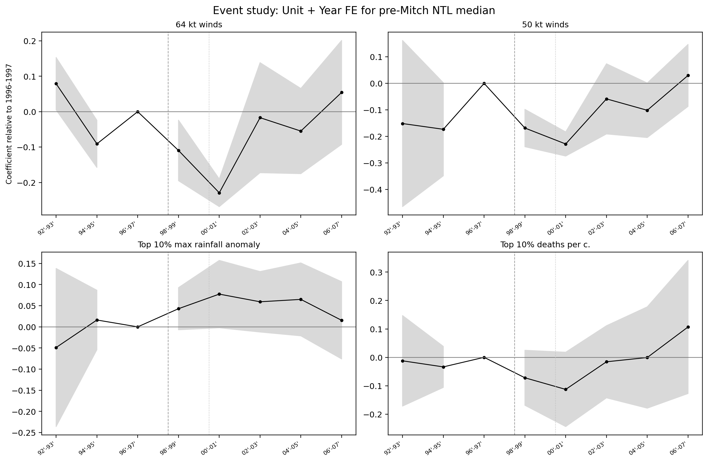

# Hurricane Mitch and Municipal Nighttime Lights

> A reproducible municipality-year study of Hurricane Mitch, nighttime lights, and local recovery in Central America, 1992–2013.

[`Coding-sample PDF`](coding-sample/Orlando_Valladares_Stata_Coding_Sample.pdf) · [`Stata master`](code/00_master.do) · [`Panel construction`](code/01_build_panel.do) · [`Estimation`](code/02_estimate_mitch.do) · [`Reproducibility`](REPRODUCIBILITY.md)

## Reviewer dashboard

| Item | Project implementation |
|---|---|
| Research question | How did Hurricane Mitch affect local economic activity, and how quickly did exposed municipalities recover? |
| Unit and window | 996 municipalities observed annually, 1992–2013 |
| Outcome | `ln(1 + DMSP-OLS stable-light sum)` |
| Design | Two-year event study with municipality and year fixed effects |
| Inference | Standard errors clustered by municipality |
| Preferred sample | 498 municipalities above the 1992–1997 pre-treatment light threshold |
| Start here | [`code/00_master.do`](code/00_master.do) |
| Submit/read first | [`Orlando_Valladares_Stata_Coding_Sample.pdf`](coding-sample/Orlando_Valladares_Stata_Coding_Sample.pdf) |

The Stata workflow constructs municipality-year nighttime lights from the public satellite-level file, checks merge cardinality and panel balance, verifies the rebuilt fields against the versioned analysis panel, and estimates the principal specifications. Wind and rainfall attributes are constructed upstream from documented geospatial inputs; their definitions and limitations remain visible rather than being hidden inside the regression stage.

In the preferred pre-Mitch-light sample, the 64-knot specification estimates coefficients of −0.110 in 1998–1999 and −0.229 in 2000–2001; the corresponding 50-knot coefficients are −0.168 and −0.228. These are changes in `log(1 + stable lights)`, not exact percentage changes in untransformed light. Treatment is not randomly assigned, the wind-treated groups are small, and satellite and boundary limitations matter; see [`METHODS_AND_LIMITATIONS.md`](METHODS_AND_LIMITATIONS.md).



## Reproduce the Stata showcase

From the repository root:

```bash
stata -b do code/00_master.do
python3 code/03_render_stata_outputs.py
```

The first command reconstructs the municipality-year nightlight panel from the public satellite-level file and documented exposure attributes, validates the real analysis panels, and estimates the preferred and supporting specifications in native Stata. The second command performs no estimation: it places Stata's coefficients, clustered standard errors, confidence intervals, and p-values into the established LaTeX and PNG designs.

Key outputs:

- [`out/results/stata/mitch_event_study_results.csv`](out/results/stata/mitch_event_study_results.csv): machine-readable Stata estimates.
- [`out/results/tables/structured/main_results/regression_tables/event_study/table_four_treatments_no34.tex`](out/results/tables/structured/main_results/regression_tables/event_study/table_four_treatments_no34.tex): principal table fragment.
- [`out/results/figures/structured/main_results/figures/event_study/year_fe_ntl_filter/fig_four_treatments_no34.png`](out/results/figures/structured/main_results/figures/event_study/year_fe_ntl_filter/fig_four_treatments_no34.png): principal event-study figure.
- [`REPRODUCIBILITY.md`](REPRODUCIBILITY.md): full, analysis-ready, and reviewer-fast reproduction paths.

## Design and data

The main municipality panel contains 996 municipalities observed for every year from 1992 through 2013. The outcome is `log(1 + stable_sum)`, where municipality-year DMSP-OLS stable-light sums are averaged across satellites when more than one satellite observes the same year. The preferred sample retains the 498 municipalities whose mean stable lights during 1992–1997 are at least 101.79.

Wind treatment equals one when at least half of a municipality's area lies inside the storm-total Extended Best Track 50- or 64-knot wind swath. Rainfall treatment identifies the top decile of maximum CHIRPS rainfall anomalies. Mortality treatment is assigned at the state level and estimated on a state-year panel. The preferred event studies omit 1996–1997, absorb unit and year fixed effects, and cluster by the panel unit.

Primary inputs are NOAA/EOG DMSP-OLS nighttime lights, NOAA Extended Best Track and IBTrACS storm data, CHIRPS precipitation, geoBoundaries administrative geometry, and compiled subnational mortality records. Modern administrative boundaries are used; they are not a reconstructed 1998 boundary vintage. No cross-satellite intercalibration is implemented.

## Repository map

```text
code/                    Stata panel construction, validation, and estimation
coding-sample/           Runnable 200-line Stata sample and three-page PDF
raw/                     Immutable source inputs
working/scripts/         Geospatial and data-construction code
working/data/processed/  Analysis-ready panels and intermediate data
out/results/stata/       Native Stata estimates
out/results/             Tables and figures
paper/                   LaTeX paper source and assets
tests/                   Stata smoke tests and static checks
```

Python remains necessary for geospatial construction and image rendering. It is not the authoritative estimator for the showcased regressions.

## Optional HTML visualizations

The HTML dashboards in `out/` are optional, AI-assisted exploratory visualization tools. They were coded to inspect newly assembled spatial and meteorological data and to guide later integration into the formal Stata analysis. They are not the replication entry point and do not supply the reported regression estimates.

- [`out/Mitch_integrated_dashboard.html`](out/Mitch_integrated_dashboard.html)
- [`out/besttrack_extended_dashboard.html`](out/besttrack_extended_dashboard.html)
- [`out/chirps_dashboard.html`](out/chirps_dashboard.html)

## Access, licensing, and software

Stata 18-compatible syntax is used and was verified with StataNow 19.5 BE. The estimators rely only on built-in Stata commands. Python requirements are listed in [`requirements.txt`](requirements.txt).

Project-authored code is released under [`LICENSE`](LICENSE). Third-party data retain their original terms: DMSP and CHIRPS are publicly distributed; NOAA storm data are openly accessible; geoBoundaries gbOpen files require attribution under CC BY 4.0; and IPUMS microdata may not be redistributed. The repository contains disclosure-safe aggregates for the census appendix, not the restricted household-level extract.

See [`DATA_PROVENANCE.md`](DATA_PROVENANCE.md) for file-level sources and [`DATA_DICTIONARY.md`](DATA_DICTIONARY.md) for the variables used by the Stata showcase.

## IPUMS Data

The raw IPUMS International fixed-width extract is not included. IPUMS licenses microdata to registered users and does not permit redistribution of the extract to third parties. The public replication therefore includes disclosure-safe, municipality-group-by-year aggregates in `working/data/replication_inputs/ipums_honduras/`; the smallest underlying household cell contains 174 sampled households. These aggregates are sufficient to reproduce the paper's census tables, refrigerator and television coefficients, standard errors, and appendix figure when `make.do` is run.

A licensed user can recreate those aggregate inputs by obtaining the Honduras extract described below, placing it at `raw/dwelling/ipumsi_00003.dat`, and running:

```bash
python working/scripts/source_prep/11_build_ipums_replication_inputs.py
```

The raw file and its local codebook remain ignored by Git.

## Lost in Translation

The main thing lost in translation from the author's machine to a public packet is the raw 632 MB IPUMS microdata extract: it is both too large for an ordinary GitHub file and, more importantly, restricted by the IPUMS user license. I therefore kept the exact cleaning script and extract specification but distributed only the small weighted aggregates used by the final paper; this makes `make.do` reproducible for the reported census results while acknowledging that a fully licensed rebuild may differ at the last floating-point decimal across Python or library versions. Large spatial inputs create a related practical difficulty, so the two largest required analytical boundary files are stored as tracked gzip archives and restored automatically at the start of the build.

## Data Inventory

Source files under `raw/` are immutable. Intermediate data live under `working/`, and final outputs live under `out/` and `paper/Paper_Figures/`.

### Publicly Packaged Inputs

- `raw/dmsp_satellite_municipality_year_1992_2013_ca7_sum_count.csv`: NOAA DMSP-OLS municipality-year stable lights and cloud-free coverage fields.
- `raw/external/ebtrk_atlc_1851_2021.txt`: NOAA Extended Best Track data used to build the Mitch 34-, 50-, and 64-knot wind swaths.
- `raw/external/ibtracs.NA.list.v04r01.csv`: NOAA IBTrACS track metadata and checks.
- `raw/external/geoboundaries_adm*.geojson`: geoBoundaries administrative geometry used in matching and maps.
- `raw/chirps_mitch_daily_stack_19981027_19981104_ca5.tif`: nine-day CHIRPS Mitch rainfall stack.
- `raw/chirps_climatology_stack_1981_present_oct27_nov04_ca5.tif`: same-calendar-day CHIRPS climatology.
- `raw/mitch_subnational_impacts.csv` and `raw/orlando_custom_mitch.xlsx`: compiled Mitch mortality and supporting exposure data.
- `working/data/processed/municipalities_adm2_analytical.geojson.gz` and `working/data/processed/did_dashboard/gaul_name_matched_municipalities_analytical.geojson.gz`: project-built analytical boundary archives restored automatically by `ensure_packaged_inputs.py`.

Source-preparation scripts and matching registries are under `working/scripts/source_prep/` and `working/municipality_boundary_match_registry.*`.

### IPUMS Extract Specification

The raw IPUMS file is intentionally absent under the [IPUMS International terms of use](https://www.ipums.org/about/terms). The final paper uses Honduras census samples for 1988, 2001, and 2013. The broader local extract also contains 1961 and 1974. Final-paper variables are `YEAR`, `SAMPLE`, `SERIAL`, `HHWT`, `GEO2_HN`, `OWNERSHIP`, `ELECTRIC`, `WATSUP`, `SEWAGE`, `FUELCOOK`, `REFRIG`, `TV`, `ROOMS`, `BEDROOMS`, `TOILET`, `FLOOR`, `WALL`, `ROOF`, `HHTYPE`, `PERNUM`, `PERWT`, `AGE`, `EDATTAIN`, `YRSCHOOL`, and `CLASSWK`.

The fixed-width column positions are declared in `working/scripts/source_prep/11_build_ipums_replication_inputs.py`. A licensed extract should be placed at `raw/dwelling/ipumsi_00003.dat` before running that script.

The distributed aggregate inputs are:

- `households.csv`: 2,727 weighted group-year cells for nine dwelling and asset measures.
- `honduras_50kt_population_education.csv`: 18 population, schooling, and worker-type summary rows.
- `honduras_50kt_dwelling_summary.csv`: 24 target-group and national dwelling summary rows.
- `honduras_50kt_ipums_geography_crosswalk.csv`: 16 treated-municipality-to-IPUMS-group crosswalk rows.

All four files are in `working/data/replication_inputs/ipums_honduras/`. No person- or household-level records are distributed.

### Local-Only Inputs

- `raw/GAUL_2024_L2.shp`: approximately 739 MB and ignored; the public pipeline uses the compressed analytical boundary archives.
- `raw/dwelling/ipumsi_00003.dat`: approximately 632 MB, licensed, ignored, and not redistributable.
- `raw/dwelling/EC64_IPUMScodebook.md`: ignored because the local export included private extract metadata; the required layout is recorded in the source-preparation script.

## Bottles Note

The author's Stata 18 installation runs inside a Linux Bottles/Wine environment. Windows Stata in that bottle cannot directly see the host Linux Python executable, although native Windows Stata with Windows Python and native macOS/Linux Stata work with the dispatch in `make.do`. On a similar Bottles setup, run the Python stages from the host terminal or install Python and the requirements inside the bottle; this environment boundary does not change the code or results.

## Expected Runtime

Runtime depends mainly on geospatial I/O and figure rendering. The raw IPUMS rebuild is optional and substantially slower; the ordinary public replication uses the packaged aggregates and does not read the restricted microdata.
